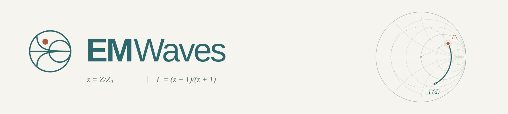
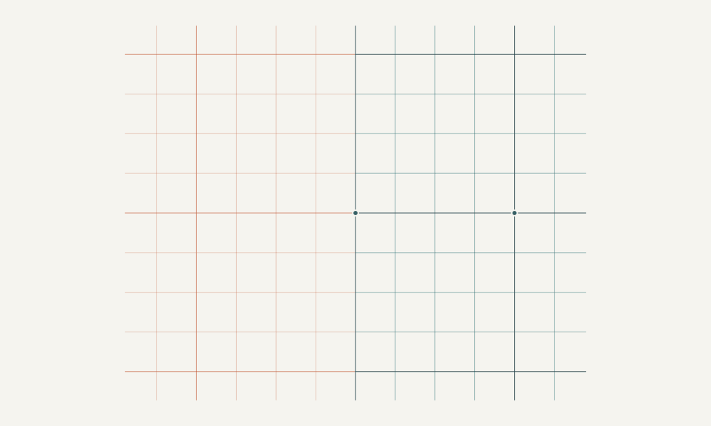
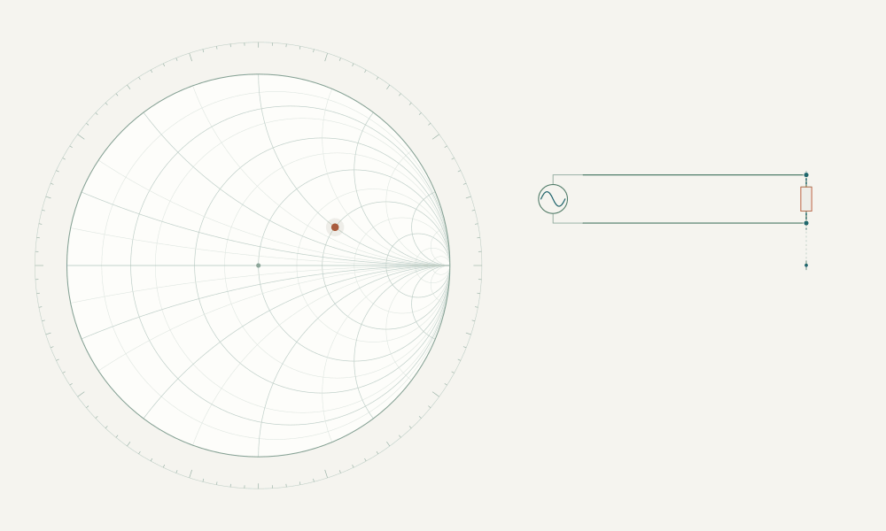
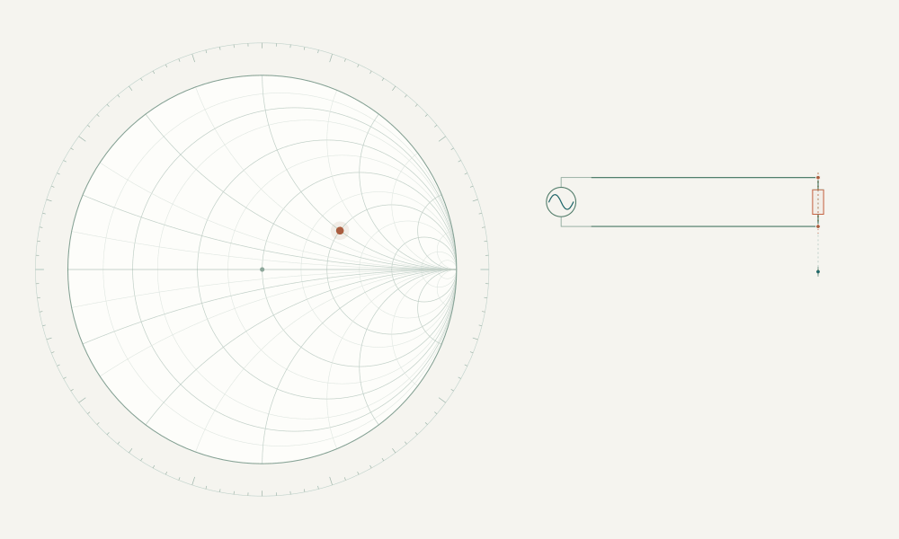

# EMWaves



As a teaching assistant, I started EMWaves to help students visualize transmission lines and impedance matching. I wanted to connect the equations we work with in class to what happens in the circuit and on the Smith chart.

That is the idea behind this project: give students a way to follow a calculation, see what each step means, and explore how changing the parameters affects the result. I hope it helps make these topics easier to understand and gives students another way to work through them outside the classroom.

**EMWaves 1.0.0** includes six laboratories and six guides in English and Spanish. Desktop downloads are available from [GitHub Releases](https://github.com/p1pe-flux/EMWaves/releases).

## How it works

EMWaves brings together a circuit, a Smith chart, and the equations that describe them. You enter the electrical parameters, and the application calculates the solution. As you move through the steps, the drawings and numerical readings follow the same operation. Results appear as the corresponding calculations are completed.

The matching constructions start paused. **Next** animates one step, **Previous** reverses it, and **Restart** returns to the beginning with the same parameters. You can adjust the movement speed or reset the example. The Smith chart explorer also lets you move the load and follow the impedance freely along a line.

The guides explain the reasoning and include interactive worked examples.

The models use ideal, lossless transmission lines and reactive components. Matching is calculated at a chosen design frequency.

<details>
<summary>A few examples of the visual constructions</summary>







The [media documentation](docs/media/README.md) explains how they are generated.

</details>

## Run it locally

Use Node.js 26 (the CI version), or a supported Node.js 22.12+ or 24 release, with npm. Run these commands from the repository root:

```sh
npm ci
npm run dev
```

Open the local address printed in the terminal. To build and preview the production version:

```sh
npm run build
npm run preview
```

You can also run EMWaves as a desktop application with Electron:

```sh
npm run desktop
```

## About the code

The interface is built with **React and TypeScript**, using **Vite**, **SVG** for the diagrams, and **KaTeX** for the equations. **Electron** provides the desktop application.

The electrical models live separately from the interface in `src/domain/`. Guides and laboratories share those calculations, while the components in `src/components/` handle the diagrams, explanations, and animation. This keeps the mathematical reasoning consistent across the different views and languages.

See the [architecture guide](docs/architecture.md) for the project structure and [contributing guide](CONTRIBUTING.md) for development commands, testing, and review conventions.

To run the unit tests and the independent circuit checks:

```sh
npm test
npm run test:models
```

Browser checks cover the interactions, layout, and translated guides. To run them locally:

```sh
npx playwright install chromium
npm run test:browser
```

For desktop packaging and platform-specific validation, see the [Windows](docs/windows-distribution.md) and [macOS](docs/macos-distribution.md) documentation.

## Contact and suggestions

I'd like to keep improving EMWaves through the experience of the people who use it. If you find a mistake, have a question, or think an explanation could be clearer, please write to **[p1peflux@protonmail.ch](mailto:p1peflux@protonmail.ch)**. Suggestions for improvements and ideas for teaching with it are welcome.

You can also [open an issue](https://github.com/p1pe-flux/EMWaves/issues) in this repository.

## License

EMWaves is licensed under the **GNU General Public License v3.0 only** (`GPL-3.0-only`). See [LICENSE](LICENSE).

Copyright © 2026 p1pe-flux and EMWaves contributors.
